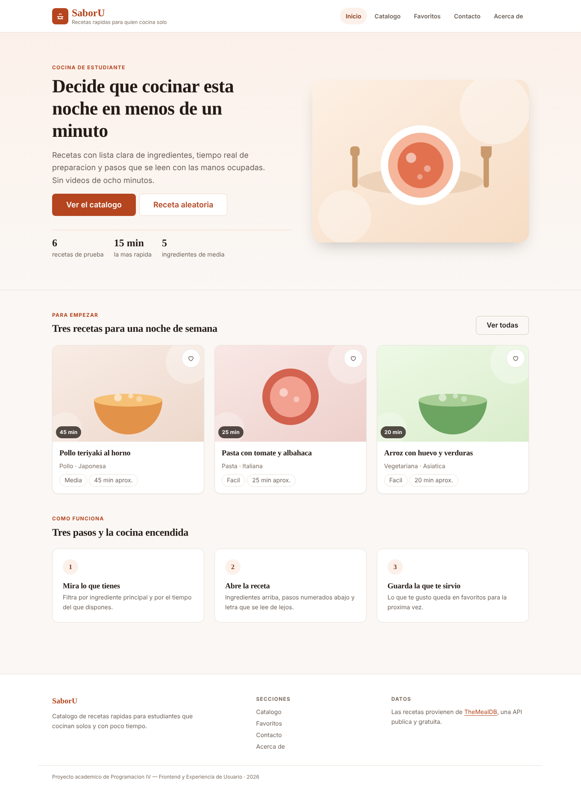
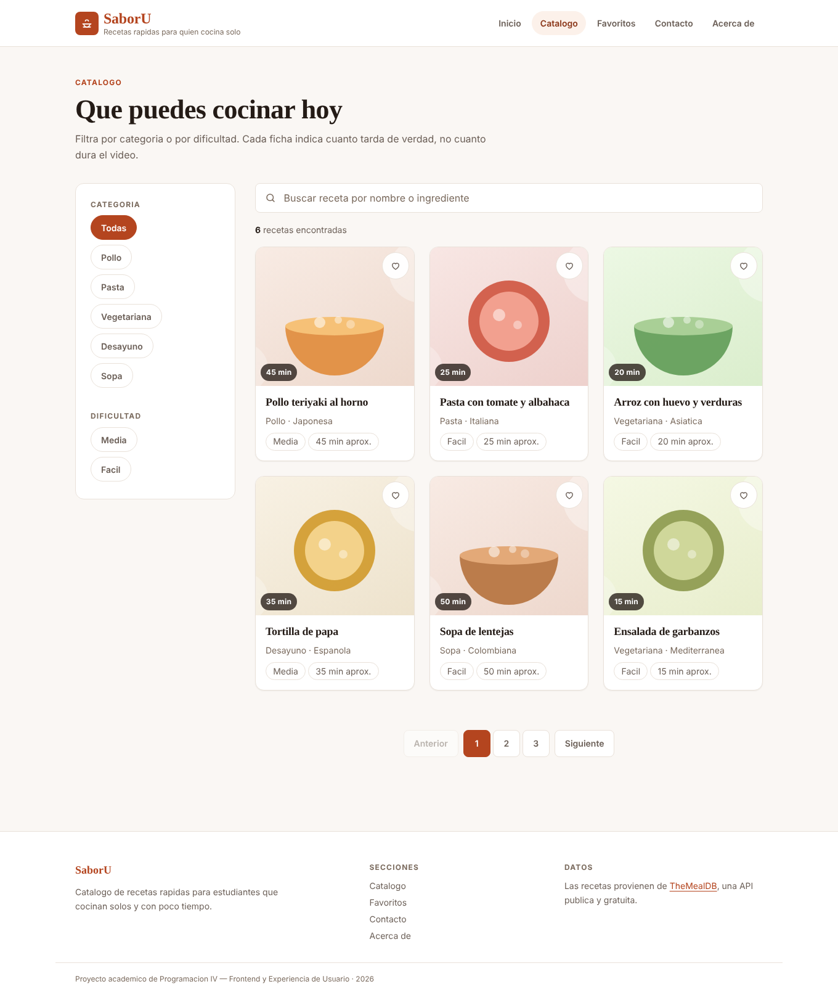
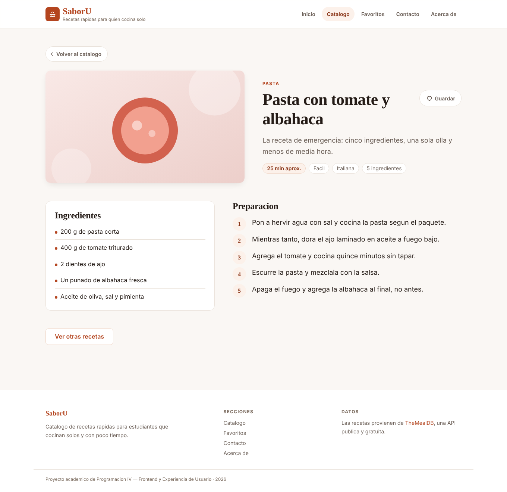

# Mockups de SaborU

Las siete pantallas con el sistema de diseño aplicado: color, tipografía y espaciado
definitivos. Conservan la estructura del [wireframe](../03-wireframe/Wireeframeindex.html)
elemento por elemento; lo único que se agregó es la capa visual.

Las decisiones de cada pantalla están explicadas en la
[Guía de interfaz](../06-guia-interfaz/guia-de-interfaz-saboru.md).

| Pantalla | Móvil | Escritorio | Clase en que se construye |
|---|---|---|---|
| Inicio | [ver](inicio-movil.png) | [ver](inicio-escritorio.png) | 4 |
| Catálogo | [ver](catalogo-movil.png) | [ver](catalogo-escritorio.png) | 5 y 6 |
| Detalle | [ver](detalle-movil.png) | [ver](detalle-escritorio.png) | 6 |
| Favoritos | [ver](favoritos-movil.png) | [ver](favoritos-escritorio.png) | 7 |
| Contacto | [ver](contacto-movil.png) | [ver](contacto-escritorio.png) | 7 |
| Acerca de | [ver](acerca-movil.png) | [ver](acerca-escritorio.png) | 4 |
| Estados (referencia) | [ver](estados-movil.png) | [ver](estados-escritorio.png) | 5 y 7 |

## Inicio

## Catálogo

## Detalle

## Cómo se exportan

Desde Figma, con la pantalla seleccionada: panel derecho, sección **Export**, formato
PNG, escala 2x.
